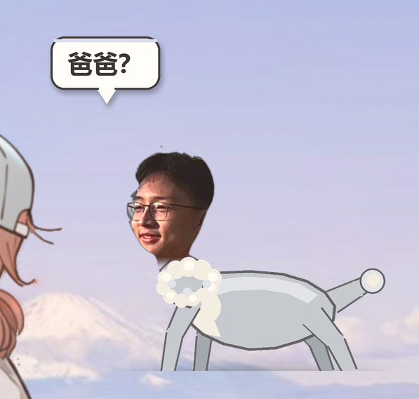

# 爸爸桌宠 · Baba Desktop Pet

一个会跟着鼠标在 Windows 桌面上爬行、时不时冒出“爸爸”的桌宠。

形象来自照片里的**人物头部**，身体按备选方案换成了**一只小狗**；没有加兜帽、项圈或其他装饰。程序只使用 Python 标准库，运行时不需要安装第三方包。



## 功能

- 跟着鼠标移动，左右转头、迈腿爬行
- 每隔约 7～15 秒冒出一句“爸爸”（随机带 `~`、`！`、`？`），停留约 3 秒
- 左键点击立刻叫“爸爸”
- 右键菜单：叫爸爸 / 暂停跟随 / 回到鼠标旁 / 退出
- 无边框、透明背景、置顶、不抢焦点
- 单实例运行，不会重复开一堆

## 环境要求

- Windows 10 / 11
- Python 3.8 或更高版本，`python.exe` 在 PATH 中（安装 Python 时勾选 **Add Python to PATH** 即可）

本项目**运行时**不需要 `pip install` 任何东西。

## 快速开始

### 1. 下载

```bash
git clone https://github.com/LQJ112358/baba-desktop-pet.git
cd baba-desktop-pet
```

或者直接在仓库页面点 **Code → Download ZIP**，解压。

### 2. 启动

双击 **`start_pet.vbs`**。

它会用 `python.exe` 在后台启动桌宠，并隐藏命令行窗口。

也可以手动在项目目录运行（会保留命令行窗口）：

```bat
python baba_pet.py
```

如果双击没反应，双击 **`start_pet_debug.cmd`**，会保留命令行窗口并显示错误信息。

### 3. 创建桌面快捷方式（可选）

1. 右键 `start_pet.vbs` → **发送到 → 桌面快捷方式**
2. 右键桌面上的快捷方式 → **属性 → 更改图标**
3. 选择项目里的 `assets/pet.ico`

本仓库不包含 `.lnk` 快捷方式文件（它带本机绝对路径，换电脑会失效）。

## 操作说明

| 操作 | 效果 |
| --- | --- |
| 移动鼠标 | 小狗跟着光标爬 |
| 左键点桌宠 | 立刻说“爸爸” |
| 右键点桌宠 | 打开菜单 |
| `Ctrl + Alt + P` | 暂停 / 继续跟随 |
| `Ctrl + Alt + Q` | 退出桌宠 |

右键菜单里也可以暂停、让它回到鼠标旁边、或者退出。

## 项目结构

```text
baba-desktop-pet/
├─ baba_pet.py              # 桌宠主程序（纯标准库）
├─ start_pet.vbs            # 无窗口启动
├─ start_pet_debug.cmd      # 带命令行启动，便于排查
├─ preview.png              # 桌面效果截图
├─ assets/
│  ├─ head_nohood.png       # 从照片抠出的人物头部
│  ├─ pet.ico               # 快捷方式图标
│  ├─ pet_icon.png          # 图标原图
│  ├─ preview_dog.png       # 爬行帧预览
│  └─ sprites/              # 预渲染的 BMP 帧（爬行 / 待机 / 气泡）
├─ tools/
│  ├─ build_dog.py          # 生成小狗身体 + 人物头部帧
│  ├─ build_final.py        # 绘制工具、气泡和 BMP 导出
│  └─ make_icon.py          # 生成 ico
└─ README.md
```

## 实现原理

- 用 Pillow 把人物头部抠出来，再和一只四腿小狗的身体合成 12 组爬行/待机帧，翻转得到左右方向。
- 气泡预渲染成 4 张 BMP，随机切换。
- 运行时用 Win32 `UpdateLayeredWindow` 做逐像素透明的置顶窗口，`GetCursorPos` 获取鼠标位置，按距离驱动爬行帧和位置。
- 不需要 WebView、Electron 或任何第三方运行库。

## 自定义

### 改说话内容

气泡文字在 `tools/build_final.py` 的 `render_bubble()` 里生成，四句文案在 `build_final.py` 的 `main()` 中：

```python
for i, text in enumerate(["爸爸", "爸爸~", "爸爸！", "爸爸？"]):
```

修改后重新生成气泡 BMP（需要 Pillow）：

```bash
python tools/build_final.py
```

### 改身体 / 动作

编辑 `tools/build_dog.py` 中的绘制坐标和颜色，然后运行：

```bash
pip install pillow numpy
python tools/build_dog.py
```

会覆盖 `assets/sprites/pet_*.bmp`。改完重启桌宠生效。

### 改跟随速度 / 说话间隔

在 `baba_pet.py` 顶部或对应位置调整：

- `MAX_SPEED`：最大跟随速度
- `self.next_say = now + random.uniform(7.5, 15.0)`：自动说话间隔

## 常见问题

**双击没反应？**
先运行 `start_pet_debug.cmd` 看报错。通常是 Python 没装，或者 `python.exe` 没加到 PATH。

**Windows 弹出“已保护你的电脑”？**
这是本地未签名脚本的 SmartScreen 提示，点“更多信息 → 仍要运行”。

**桌宠跑到屏幕外了？**
右键菜单选“回到鼠标旁边”，或按 `Ctrl+Alt+Q` 退出后重新启动。

**为什么是狗的身体？**
提供的照片只有上半身，无法直接抠出一个完整、能爬行的真人下半身。按需求里的备选方案，身体使用了小狗；人物头部保留自照片。如果之后提供全身照，可以替换身体素材。

**会不会很占资源？**
只有鼠标移动或动画帧变化时才重绘；静止时基本不占 CPU。

## License

未指定许可证。图片来自个人照片，请勿用于侵犯肖像权的用途。
